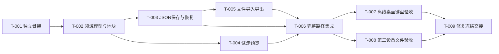

# 两周依赖与交付计划

状态：计划，尚未实施。工期来自用户“两周”；按10工作日安排是假设，不指定虚构开始/截止日或每日工时。负责人：单人维护者。唯一任务状态拥有源为 tasks.json。

## 顺序与小切片

| 时间窗口（建议） | 任务 | 可评审结果 | 阻塞条件 |
| --- | --- | --- | --- |
| D1 | T-001 | 独立工程、本机固定地址、离线包启动骨架、实际设备记录 | 缺Node/浏览器或端口占用先解决；不能借旧服务冒充新工程 |
| D2–D3 | T-002、T-003 | 地块规则、显式JSON本机保存、刷新恢复与失败提示 | T-001先完成；validator是后续共同依赖 |
| D4–D5 | T-005、T-004 | 文件往返与不污染编辑状态的试走预览 | 前两项数据模型稳定；独立模块可分别实现但由一人顺序处理 |
| D6 | T-006 | 编辑→预览→保存→刷新→导出→导入完整用户路径 | 保存、文件、预览任一失败则不关此任务 |
| D7–D8 | T-007、T-008 | 离线冷启动、桌面/键盘、第二设备文件往返真实记录 | 准备好干净浏览器和第二设备；第二设备缺失明确阻塞T-008 |
| D9–D10 | T-009 | 修复关键失败、冻结版本、离线交付包与独立交接 | 所有核心验收完成；CI/部署如无任务不伪填成功 |

任务粗估合计9工作日，保留D9–D10中的1日为缓冲；估算没有经过实际实施验证。缓冲优先用于保存/恢复/文件兼容/离线启动缺陷。超过可投入时间时先减少装饰、尺寸设置和额外地块，不能删掉用户明确的核心闭环。开始日期与投入能力记录在实施日志。

## 依赖图

首个数据闭环里程碑 M1 包含T-001/T-002/T-003/T-005；完整试走 M2 再包含T-004/T-006；离线交付 M3 依赖全部任务。

## 文件所有权与工程约定

本次规划拥有 /tmp/youzao-fresh-project/ 文档；game_engineer由其他 agents 负责，本任务只读。未来单人维护者拥有 implementation/。若后续授权并行，先在tasks.json声明具体文件所有者，领域模型不能由多个任务各自复制规则。

建议工程布局：src/domain/level.ts、src/domain/level.test.ts；src/features/editor/**；src/features/preview/**；src/adapters/local-storage.ts、json-file.ts；src/styles.css；scripts/launch.mjs；tests/e2e/**。T-001建立 package.json、锁文件与 npm run check 后才称其存在。npm ci/浏览器安装只用于开发准备，离线发行包运行不应要求下载。

## 完成与阻塞规则

完成记录必须包含：taskId、执行者、日期、命令或步骤、退出状态/观察结果、相对证据路径、实际Git提交（如有）、设备/版本、限制。计划截图/样本不等于导出证据。

依赖未完成时任务保持blocked；完成任务的 evidence 不得为空。前置重开时把依赖其行为的下游证据标记待复议，重新打开对应里程碑；历史证据保留但不能继续表示当前版本通过。

不安排线上部署、排行榜或视频渲染；新项目GitHub CI只有建立远端后实际读取当前commit检查才记录。没有远端不是本机实施阻塞。第二设备不可用时保持T-008/M3未完成，先完成独立会话与离线本机验证并标出限度。

本次实际运行记录与未来验收分开在 acceptance.md。当前未建立新工具工程，所有任务未开始。
